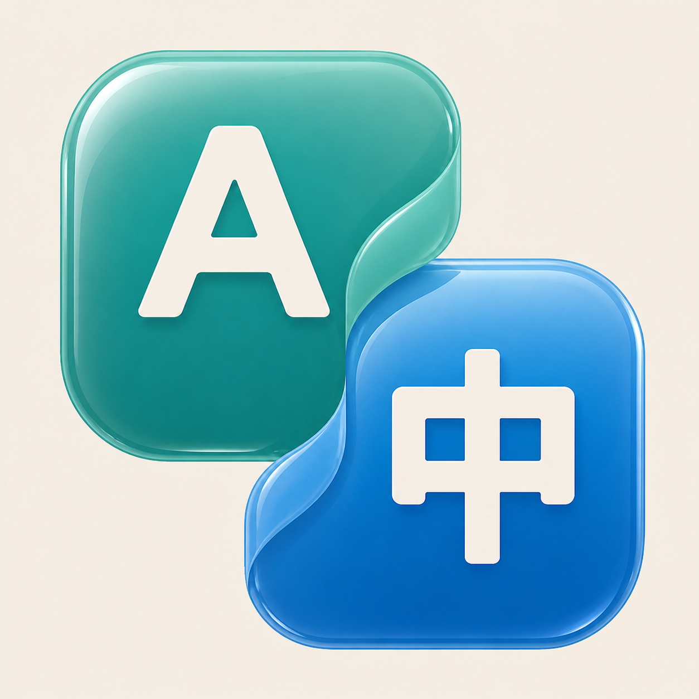

# 老叶奇妙工具



一款驻留在 Mac 菜单栏的工具，包含屏幕翻译、Dock 点击最小化和调度中心窗口管理。

[下载最新版](https://github.com/y2675632584-hub/screen-translator/releases/latest) · [隐私说明](PRIVACY.md)

## 功能

- **屏幕翻译**：按快捷键识别鼠标所在显示器中的文字，在原文位置覆盖译文；再次按键关闭。支持实时和单次模式、源语言自动识别或手动选择、目标语言与字号设置，覆盖层允许鼠标点击穿透。
- **Dock 增强**：可选开启，点击已在前台的应用图标来最小化窗口。首次使用需要在系统设置中授权辅助功能。
- **调度中心增强**：可选开启，在窗口缩略图点击“×”，或将鼠标指向缩略图并在触控板双指上下滑动以关闭窗口；系统会重新排列其余窗口。关闭使用应用自己的关闭操作，未保存内容由原应用提示处理。
- 菜单栏提供设置、自定义快捷键和开机启动选项。

## 系统要求与安装

- Apple Silicon Mac，macOS 26 或更高版本；调度中心增强在开发者的 macOS 27 设备上测试。
- 在 [Releases](https://github.com/y2675632584-hub/screen-translator/releases/latest) 下载 `ScreenTranslator-macOS-arm64.zip`，解压后把 `老叶奇妙工具.app` 拖到“应用程序”。
- 首次使用屏幕翻译时，按提示允许屏幕录制，并下载所需的系统翻译语言包。默认快捷键是 **F8**，部分键盘需要 **Fn + F8**。
- 使用窗口管理功能时，在设置的“Mac 增强”中打开相应开关，并按系统提示授权辅助功能。
- 公开包目前使用临时签名，未经过 Apple 公证。若系统阻止首次打开，请在 Finder 中按住 Control 点击应用，选择“打开”；或在“系统设置 → 隐私与安全性”中选择“仍要打开”。更换版本后系统可能要求重新授权。

## 隐私

- 屏幕识别和系统翻译在设备上处理，不保存截图、识别文字或翻译历史，也不将这些内容发送给项目维护者。
- 开启窗口管理功能后，应用使用辅助功能读取窗口信息并监听必要的鼠标或触控板事件，以识别并执行操作。关闭功能后停止监听。
- 详情见 [隐私说明](PRIVACY.md)。

## 从源码构建

需要 Xcode 26.4 或更新版本（包含 macOS 26.4 SDK）和 Swift 6：

```sh
bash scripts/build-app.sh
```

输出位于 `dist/老叶奇妙工具.app`。运行测试：`swift test --disable-sandbox`。

## 已知限制

- 受保护的视频画面、过小文字、艺术字体和低对比度内容可能无法识别；不承诺视频字幕逐帧翻译。
- 调度中心增强依赖系统窗口信息；不同 macOS 版本、外接显示器和不同应用的兼容性可能不同。如果无法唯一确定窗口，软件会拒绝关闭，避免误关。
- 双指滑动直接关闭窗口，没有跟随手势滑出的动画；触控板手势和系统调度中心行为可能存在冲突。
- 部分 Mac 的系统授权在更新应用后需要重新添加。

本项目采用 [MIT License](LICENSE)。
